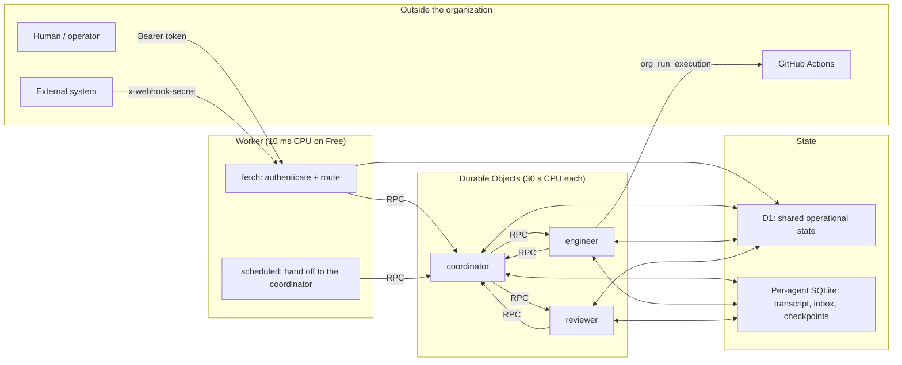
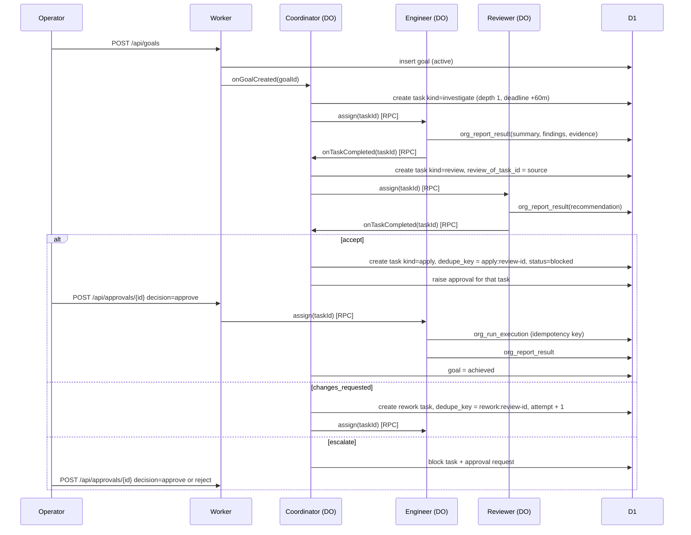
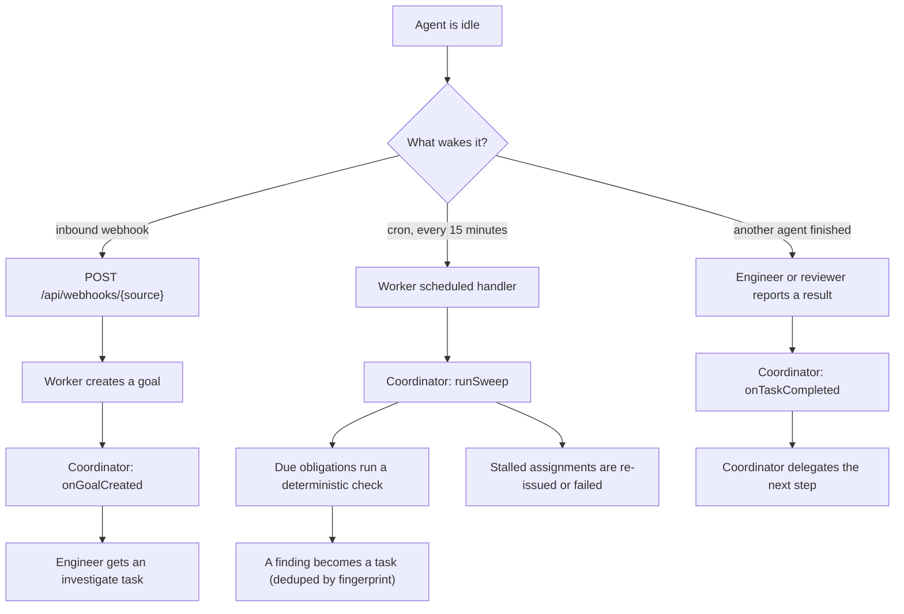

# Architecture

Incorporeal is an organization of persistent, proactive AI agents running on
Cloudflare Workers.

The central principle of the system:

> **Agents are durable members of an organization, while tasks, model calls
> and execution environments are disposable.**

Everything below follows from that sentence. An agent is something with an
identity, a role, a set of permissions and a memory that survives a restart.
A task is a row that can be created, failed and retried. A model call is a
single request to a provider. An execution environment is a CI runner that
comes and goes. Only the first of those four things is modelled as a durable
citizen of the organization.

## Overview

Three agents ship with the organization, each with a distinct role and a
distinct permission set:

| Agent | Role | Holds | May not do |
| --- | --- | --- | --- |
| Coordinator | `coordinator` | goals, assignments, deadlines, escalations | run code itself |
| Engineer | `engineer` | its own working memory | delegate, approve |
| Reviewer | `reviewer` | its own working memory | write tasks, delegate, approve, execute |

The Worker is ingress and scheduler only. It authenticates a request, routes
it, and hands the work to a Durable Object. It holds no agent state of its
own. The reason is concrete: on the Workers Free plan a Worker invocation
gets 10 ms of CPU, while a Durable Object invocation gets 30 s of CPU and
about 15 minutes of wall time (`src/index.ts`, `wrangler.jsonc`). Any real
work therefore happens inside a Durable Object, and the Worker's job is to
get out of the way.

## Component map

| Path | Responsibility |
| --- | --- |
| `src/index.ts` | The Worker: `fetch` ingress, the single `scheduled` cron trigger, and the `OrgAgent` Durable Object export. |
| `src/api/routes.ts` | The management API: goals, tasks, agents, obligations, approvals, knowledge, events, webhooks, manual sweeps. |
| `src/auth.ts` | Two credentials (management token, webhook secret), compared in constant time. |
| `src/agents/org-agent.ts` | The `OrgAgent` Durable Object class: one class, every agent, named by agent id. |
| `src/agents/identity.ts` | Who an agent is: role, title, permissions, budgets, model, thinking level. Seeded into D1 on first use. |
| `src/agents/tools.ts` | The `org_*` tool surface a model can call, with the permission and budget checks inside each tool. |
| `src/agents/docs.ts` | `AssignmentDoc`: the agent-private durable record of which organizational task it is working on. |
| `src/agents/faux.ts` | A deterministic stand-in model provider for tests and credential-free demonstrations. |
| `src/db/org.ts` | The shared operational store: agents, goals, tasks, obligations, approvals, knowledge, executions, usage, events. |
| `src/policy/permissions.ts` | The permission vocabulary and the default set per role. |
| `src/policy/budget.ts` | Per-task and per-agent tool-call ceilings. |
| `src/execution/*` | Pluggable execution backends: `simulated`, `github-actions`, `none`. |
| `src/checks/*` | Pluggable deterministic repository checks: `simulated`, `github`. |
| `src/logging.ts` | One JSON object per log line. |
| `migrations/0001_init.sql` | The D1 schema, including the uniqueness indexes that make delegation safe to replay. |
| `.github/workflows/agent-task.yml` | The repository's own entry point for the `github-actions` backend: a `workflow_dispatch` whose `command` input is matched against an allowlist. |
| `AGENTS.md` | The rules, commands and conventions for anyone working in this repository, human or agent. |

## The state split

Two stores, with a deliberate line between them.

| State | Lives in | Why there |
| --- | --- | --- |
| pi-durable transcript, inbox, sessions, running generation | The agent's own Durable Object SQLite database | It is the agent's working memory. It is private to that agent, it is large and append-only, and it has no meaning outside the agent that wrote it. pi-durable owns its schema and lifecycle. |
| Task checkpoints, current assignment (`AssignmentDoc`) | The agent's own Durable Object SQLite database | A tool call that arrives after an eviction still needs to know which organizational task it belongs to. That is a fact about the agent's own work, not about the organization. |
| Agents, goals, tasks, obligations, approvals, shared knowledge, executions, usage, events | D1 | This state is genuinely relational and shared. A task references a goal, an assignee, an approver, a review and a source task. Every agent needs to read the same rows, and the coordinator needs to query across all of them. |

### Why D1 for the shared state

The shared state is not a document store and not a log. It has foreign-key-like
references, it needs multi-row queries ("every open task for this goal", "the
pending approval for this task"), and it needs conditional updates that two
concurrent agents can race on without one of them clobbering the other.
D1's SQL gives exactly that:

- `markTaskRunning` updates a task to `running` only `WHERE status NOT IN
  ('completed', 'failed', 'cancelled')`, so a late assignment cannot drag a
  finished task back into flight and lose its recorded result.
- `completeTask` writes a result only `WHERE ... AND result IS NULL`, so the
  agent's own structured report is never overwritten by the harness fallback.
- `decideApproval` updates only `WHERE status = 'pending'`, so a replayed
  decision cannot overwrite a human's earlier choice.
- `claimObligation` is a single conditional update that sets a lease, so two
  overlapping sweeps cannot both run the same obligation.

Those are races with real consequences, and conditional SQL is the cheapest
correct way to settle them.

### Why the transcript is not the task database

The transcript is the wrong shape for organizational state, and the code keeps
them apart on purpose.

- The transcript is per agent and unstructured. The organization needs to ask
  questions across agents: "which tasks are open", "which findings are
  already covered", "what has this agent spent today". Those are queries over
  a table, not over a chat log.
- The transcript is not shared and must not be. A successor agent inherits the
  organization's commitments but starts with an empty working memory
  (`POST /api/agents/{id}/successor`); the test suite asserts that the
  predecessor's transcript does not appear in the successor's. Moving tasks
  into the transcript would break that separation.
- The transcript is append-only and grows without bound; the task board is
  mutable and indexed.
- A transcript cannot enforce a uniqueness rule. Two obligations firing at
  once must not produce two tasks for the same finding, and that is enforced
  by a unique index on `tasks.fingerprint`, not by anything a model writes.

So: D1 answers "what does the organization owe, to whom, and what happened";
the agent's own SQLite answers "what have I been doing".

## The task lifecycle

The goal-to-approval flow is a bounded, explicit chain. Each step is a row in
D1 with an id, an owner and a deadline, not a message in a conversation.

Task kinds are `investigate`, `research`, `review` and `apply`. Statuses are
`pending`, `assigned`, `running`, `blocked`, `completed`, `failed` and
`cancelled`.

The chain is deliberately shallow:

- The reviewer's task always carries `review_of_task_id` pointing at the task
  it assesses, and the coordinator creates it with the reviewer's agent id as
  assignee. A reviewer is never asked to review work it produced.
- The rework and apply steps each carry a `dedupe_key` derived from the
  review task id, so a replayed handoff finds the existing step instead of
  stacking a second one.
- `apply` is the only externally consequential step, and it is created
  `blocked` with an approval request attached. It starts only after a human
  approves it through the management API. The task is created before the
  approval request, so a replay raises no second approval for the same
  review.

## Wake mechanisms

The organization does not wait to be spoken to.

Three mechanisms, each with a different trigger:

1. **An inbound event.** `POST /api/webhooks/{source}`, authenticated with
   `WEBHOOK_SECRET` (a different credential from the management token, because
   it is a different trust boundary), creates a goal. The coordinator turns
   the goal into an `investigate` task for the engineer.
2. **A scheduled obligation.** The only cron trigger in the system is
   `*/15 * * * *` in `wrangler.jsonc`. The Worker handler does the least
   possible work: it asks the coordinator's Durable Object to `runSweep()`.
   The sweep runs due obligations through a deterministic check and looks for
   stalled assignments. The reason for the hand-off is CPU: the Worker has
   10 ms, the Durable Object has 30 s.
3. **An asynchronous assignment.** When the engineer reports a result, the
   coordinator is called directly over Durable Object RPC and delegates the
   next step. The handover is a D1 row plus an RPC call, not a chat between
   agents.

An assignment is not a message in a transcript. It is a row with an assignee,
a deadline and an attempt limit, and the agent's Durable Object is addressed
by name to pick it up.

## Roles and permissions

The permission vocabulary lives in `src/policy/permissions.ts`:
`task.read`, `task.report`, `task.delegate`, `task.approve`,
`knowledge.read`, `knowledge.write`, `execution.run`. Every name in it is
checked by a tool; there is no permission that no tool enforces.

| Permission | coordinator | engineer | reviewer |
| --- | --- | --- | --- |
| `task.read` | yes | yes | yes |
| `task.report` | yes | yes | yes |
| `task.delegate` | yes | — | — |
| `task.approve` | yes | — | — |
| `knowledge.read` | yes | yes | yes |
| `knowledge.write` | yes | yes | yes |
| `execution.run` | — | yes | — |

Two properties make this a control rather than a convention:

1. The permission set is **data**. It is a JSON array on the agent's row in
   D1. A model instruction to "grant yourself execution rights" is text; it
   changes no row.
2. Every tool **re-reads the row inside `execute()`**, on every call. Being
   offered a tool is a convenience; the check inside the tool is the control.
   A permission revoked while an isolate was alive takes effect on the next
   call.

### The reviewer's independence

The reviewer holds `task.read`, `task.report`, `knowledge.read` and
`knowledge.write`. It cannot write tasks, cannot delegate, cannot approve,
and cannot execute. It therefore cannot accept its own work, cannot extend
the chain, and cannot cause an external effect. The coordinator, which can do
all of those things, assigns the review to a different agent and attaches the
source task id to it.

What the reviewer is not: it is not an independent process. It is the same
Durable Object class, the same code, and possibly the same model provider as
the engineer, with a different identity row, a different transcript and a
narrower permission set. Its independence is organizational and enforced by
policy, not a separate trust boundary or a different vendor.

## Bounds that prevent runaway agent-to-agent conversation

Left alone, a set of agents that can talk to each other will talk until the
allocation is gone. The bounds are:

- **Explicit task ids.** Every unit of work is a row with an id
  (`task_<base32 time><random>`), an assignee and a deadline. There is no
  free-floating conversation to continue.
- **One review per source task.** A unique index on
  `tasks(review_of_task_id)` means a replayed delegation cannot create a
  second reviewer for the same work. Note that `review_of_task_id` is never
  cleared, so this is one review per source task for good, not one open
  review.
- **One open task per finding fingerprint.** A unique index on
  `tasks(fingerprint)` means a recurring obligation that reports the same
  failing workflow cannot stack duplicate work. Unlike the review
  reference, the fingerprint is released when the task completes
  (`fingerprint: null`), so a later occurrence can open a fresh task. The
  obligation also remembers the finding it last acted on, and a **cooldown**
  (`max(interval x 4, 1 hour)`) stands between two tasks for the same
  failure. Without it, a permanently failing workflow would produce a new
  task, a new review and a new approval every fifteen minutes.
- **One task per step of a chain.** A unique index on `tasks(dedupe_key)`
  means a replayed handoff cannot stack a second step. The apply step uses
  `apply:<review task id>` and the rework step uses `rework:<review task id>`.
  This matters because the apply step is the one that raises a human
  approval: before the key existed, a replayed handoff produced three apply
  tasks and three approvals for the same review. The apply task is now
  created *before* its approval request, so a replay finds the existing task
  and raises no second approval.
- **Delegation depth.** `MAX_DELEGATION_DEPTH = 2` in `src/agents/tools.ts`.
  A delegation beyond that is refused with an error the model can report.
- **Attempt limits.** Every task has `max_attempts` (default 2). A reviewer
  who asks for changes beyond the limit escalates to a human instead of
  looping; a stalled task beyond the limit fails with a recorded reason.
  The attempt counter travels with the task: a rework task is created with
  `attempt = source.attempt + 1`, so the limit is measured against the work
  as a whole and not against each round.
- **Deadlines.** Every delegated task carries a deadline (60 minutes by
  default). The sweep treats a task past its deadline as stalled.
- **Tool-call budgets.** A per-task ceiling (`agents.max_tool_calls`, default
  20) and a per-agent daily ceiling (`DAILY_TOOL_CALL_LIMIT = 200`). When a
  budget is reached the tool refuses the call with a normal error result, so
  the model can report what it has and stop. The daily budget is charged on
  every tool call, whether or not the call then succeeds.
- **Token budgets.** A per-task ceiling (`agents.max_tokens`, default
  120,000). The agent measures the tokens its run spent when the run
  settles; a task that passed its ceiling is failed with the reason rather
  than quietly costing more than planned.
- **Human approval gates.** Anything that changes the outside world waits for
  a human, and the check does not depend on the task's own flags: a task is
  data, and data does not grant authority. `org_run_execution` requires an
  **approved** request on the task, whatever the task says about it. The
  `apply` step is the task that carries one, and it is created blocked until
  a human decides.

## Idempotency and recovery

Three separate mechanisms, because there are three separate places a replay
can do damage.

**Model runs.** A task's run always uses the same pi operation id,
`task:<task_id>` (`operationIdFor`). A replay after an interruption rejoins
the run that is already under way instead of starting a second one; the
harness reports `accepted: false` and the agent logs "rejoined an existing
run".

**External actions.** `org_run_execution` records the action in D1 under a
caller-supplied idempotency key, against a unique index on
`executions(idempotency_key)`. A replay finds the first record and returns
the recorded outcome instead of running the command twice. The tool is also
declared `replay: "safe"`.

**Racing state transitions.** Conditional SQL, as described above under
"why D1 for the shared state".

**Recovery.** Three paths:

- On every start an agent reconciles the shared store with its own state:
  `#reconcile` lists open tasks, finds the ones assigned to this agent, and
  rejoins them (skipping tasks that require a human approval). Because
  submissions are idempotent, rejoining does not start a second run.
- A stalled assignment — one that passed its deadline without finishing — is
  detected by the coordinator's sweep. It is re-issued once with a fresh
  30-minute deadline, and on the next stall it is failed with the reason
  recorded and the coordinator notified.
- A missed handoff is repaired by the same sweep: if the coordinator was not
  notified that a task completed, the sweep's stalled-task scan eventually
  notices the task is still open.
- **An escalation does not reopen finished work.** When the coordinator
  escalates to a human, the review and the source task stay completed: the
  escalation is recorded on the approval and the goal is blocked. Reopening
  them would make the reviewer answer again, which would raise another
  approval, which would reopen them again. The approval API only unblocks a
  task that is actually waiting, and a decision that has already been taken
  is answered without repeating its side effects.
- **External actions are reconciled.** An execution is submitted and then
  forgotten, so the sweep asks the backend what became of it and writes the
  answer down. Without that, every execution would read `submitted` for
  ever.

## Security model

**Two credentials, two trust boundaries.** `ORG_API_TOKEN` authorizes the
management API; every agent-control endpoint requires it. `WEBHOOK_SECRET`
authorizes inbound webhooks, which come from outside. Both are compared in
constant time, and a 401 does not say which part was wrong. Secrets live in
`wrangler secret put` and are never logged; the logging helpers only accept
ids, counts and short labels.

**The Durable Object RPC surface is not reachable from outside.** Agents talk
to each other through D1 rows and `ORG_AGENTS.getByName(...)` calls made
from inside the Worker. An external caller cannot address an agent's Durable
Object directly; it can only ask the management API, which requires the
token.

**Model output is untrusted.** The `org_*` tools are the only way a model can
affect the organization, and each one re-checks the permission against the
agent's row at call time. Delegation checks the assignee exists and is
active. `org_run_execution` checks the approval state before it records
anything. `org_delegate` checks the depth limit. Task ids and agent ids
appear in tool arguments, so ids are unguessable by design. A report names
the task it is about, so it cannot land on a different task the agent also
holds.

**Externally consequential work is gated on a human.** The gate does not
depend on the task's own flags: `org_run_execution` requires an approved
request on the task, whatever the task says about it. A task is data, and
data does not grant authority — a task created by a model cannot mark
itself approved. The `apply` step is the task that carries such a request,
and it is created blocked until a human decides.

**There is no multi-tenancy.** One deployment is one organization. There is
one token, not per-user identities, and `decidedBy` on an approval is a free
string recorded for the audit trail.

## Observability

- **Structured logs.** One JSON object per line (`src/logging.ts`), with
  `ts`, `level`, `msg` and typed fields (`agentId`, `taskId`,
  `correlationId`, `obligationId`, `durationMs`). Errors are logged as a
  message via `describeError`, never as a stack trace.
- **An event log in D1.** Every meaningful transition writes a row to
  `events` with a correlation id: `task.created`, `task.started`,
  `task.reported`, `task.review_requested`, `task.rework_requested`,
  `approval.requested`, `approval.approved`, `task.stalled_retried`,
  `task.stalled_failed`, `execution.submitted`, `agent.replaced`,
  `webhook.received`, and others. It is queryable through
  `GET /api/events`, which honours `?task=`, `?agent=`, `?type=` and
  `?limit=`, and through `GET /api/tasks/{id}/events`. The filters run in
  the database, so the log is not truncated to the recent window before they
  are applied.
- **Inspection endpoints.** `GET /api/agents/{id}` returns the agent's
  identity, its permissions, its open tasks, its pending pi operations, a
  bounded preview of the newest transcript entries, its pi usage and its
  sessions. `GET /api/tasks/{id}/events` gives the history of one unit of
  work.
- **A CLI.** `scripts/orgctl.mjs` drives the same API for operators. Its
  `events` command passes `?task=`, `?agent=` and `?type=` through to the
  server rather than filtering client-side.

## Extension points

- **A new model provider.** `src/agents/org-agent.ts` installs a provider into
  pi's model registry: `createAI({ binding: env.AI })` for Workers AI, or
  `createFauxProvider(...)` when `MODEL_PROVIDER === "faux"`. Any provider
  pi-ai supports can be registered here. The per-role model is configuration
  (`MODEL_COORDINATOR`, `MODEL_ENGINEER`, `MODEL_REVIEWER`,
  `MODEL_DEFAULT`), and an individual agent can override it on its row. A
  Cloudflare AI Gateway id such as `openai/gpt-4o-mini` works in the same
  variables: the gateway holds the provider's credentials, so there is no
  separate configuration for an external provider.
- **A new execution backend.** Implement the `ExecutionBackend` interface in
  `src/execution/types.ts` (`submit` and `status`) and select it in
  `src/execution/index.ts`. `github-actions` dispatches a workflow;
  `simulated` records the request and reports success; `none` refuses every
  action, which is a valid configuration for a read-only organization.
  Cloudflare Containers are deliberately not used: they are a Workers Paid
  feature.
- **A new repository check.** Implement `RepositoryCheck` in
  `src/checks/types.ts` and select it in `src/checks/index.ts`. A check is a
  bounded, repeatable inspection that produces findings with stable
  fingerprints; it is not a model call, so the organization can notice
  trouble without spending an allocation.
- **A new agent role or agent.** Add a row to the `agents` table, or seed it
  in `src/agents/identity.ts`. The Durable Object class does not change: the
  object's name is the agent id. Give the role a permission set in
  `ROLE_PERMISSIONS` and it will be enforced on the next tool call.
- **A new tool.** Add it to `createOrgExtension` in `src/agents/tools.ts`
  with a `requirePermission` check and a `chargeToolCall` charge. The
  `guarded` wrapper logs any failure.

## The organization working on its own repository

The `github-actions` execution backend is the path by which the organization
acts on this repository. `.github/workflows/agent-task.yml` is a
`workflow_dispatch` workflow whose inputs are exactly `command`, `args` and
`notes` — the three fields the backend sends, and the whole interface
between the organization and the repository.

The command is not run as a shell command. The workflow matches the input
against a fixed allowlist of the repository's own commands — `test`,
`typecheck`, `check` and `build` — and refuses anything else with an error
annotation. A workflow runner is a sandbox, but a sandbox holding the
repository's credentials and its network is not a place to execute text a
model produced. A model's instruction is data, never authority.

This is the first working sandboxed implementation of the execution
interface: `EXECUTION_BACKEND=github-actions` with `GITHUB_REPO`,
`GITHUB_WORKFLOW=agent-task.yml` and a `GITHUB_TOKEN` lets an engineer's
`org_run_execution` call actually run this repository's own checks.

`AGENTS.md` at the root of the repository is the other half of the same idea:
it states the rules an agent needs in order to work here — the commands, the
conventions, the design constraints, and the rule that a behavioural change
needs a test that would fail without it. It is written in the same voice as
the instructions the agents give each other.

## Known limitations and future work

Stated plainly, because they are real.

- **No vector store for shared knowledge.** `knowledge` is a D1 table read
  back with `listKnowledge`, most recent first, with a limit. There is no
  embedding, no similarity search and no retrieval. An agent that needs to
  recall something old has to read a list.
- **The reviewer is not an independent process.** It is the same class, the
  same code and possibly the same model as the engineer, with a different
  identity and a narrower permission set. A stronger guarantee would mean a
  separate provider or a separate trust boundary.
- **There is no model gateway abstraction of its own.** The provider is
  configurable per role and per agent, and Workers AI or the deterministic
  faux provider can be installed, but the code has no gateway layer of its
  own. The Cloudflare AI Gateway is reached through the Agents SDK's
  `createAI` provider: put a gateway id such as `openai/gpt-4o-mini` or
  `anthropic/claude-haiku-4-5` in a `MODEL_*` variable and the gateway holds
  the provider's credentials and takes the billing. There is no
  Incorporeal-specific routing, quota or fallback logic on top of that, and
  no separate configuration for a non-gateway external provider.
- **Delegation from the `org_delegate` tool does not push the task.** The tool
  creates the task row and records the event, but it does not call
  `assign()` on the assignee the way the coordinator's own delegation paths
  do. A delegated task is picked up when the assignee's Durable Object next
  starts and reconciles, or when the sweep re-issues it as stalled. The
  coordinator's delegations (goal, review, rework, apply) do push directly.
- **The daily tool-call budget is charged through `bumpAgentUsage`; token spend
  is recorded separately by the agent after a run
  (`bumpAgentUsage(db, agentId, 0, tokens)`) and checked against the agent's
  `max_tokens` when the run settles.** The daily ceiling therefore counts
  tool calls; the per-task ceiling counts tokens, and a task that passes it
  is failed with the reason rather than quietly costing more than planned.
- **Every permission in the vocabulary is enforced by a tool.** The set is
  exactly `task.read`, `task.report`, `task.delegate`, `task.approve`,
  `knowledge.read`, `knowledge.write` and `execution.run`. Earlier drafts
  carried `task.write` and `goal.manage`, which no tool checked; they were
  removed rather than left as decoration.
- **The approval for the `apply` step is raised after its task.** The task is
  created first, so that its `dedupe_key` makes the step unique, and the
  approval row is written with a null `task_id`. The approval API therefore
  has to resolve the task in both directions: by `approval.task_id` for an
  approval raised against an existing task, and by `tasks.approval_id` for
  the `apply` step. Both directions are handled, but the two-way lookup is a
  consequence of the ordering rather than a clean design.
- **One organization per deployment.** No tenancy, no per-human identities,
  no quota partitioning between agents beyond the shared daily tool-call
  ceiling.
- **Stall detection is deadline-based.** A task that is making progress but
  has passed its deadline is treated as stalled. There is no heartbeat or
  progress signal.
- **The event log grows without bound.** There is no retention or rollup
  policy for `events`.
